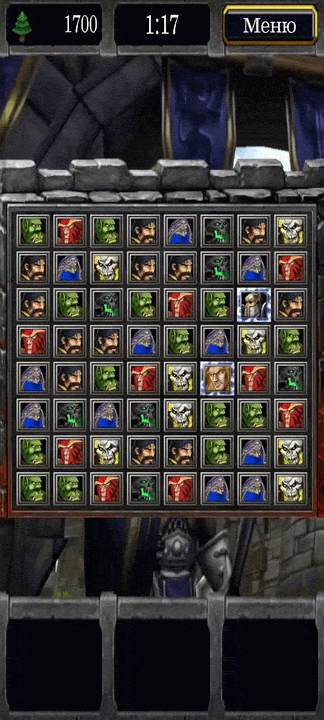
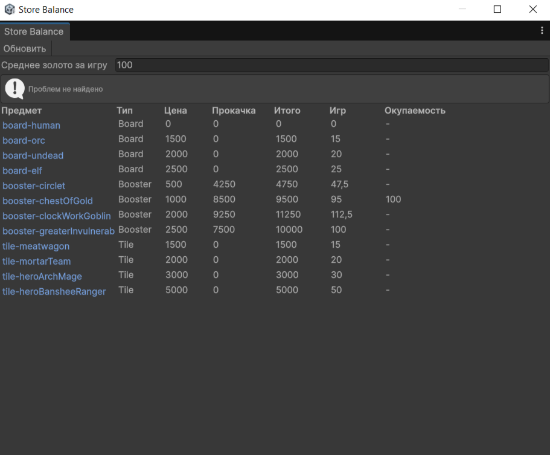

# Warcraft: Puzzle of Legions

Мобильная игра «Три в ряд» на Unity с магазином, прокачкой бустеров и спец-тайлами. Один режим: игра на время.

> Некоммерческий фанатский проект для личного портфолио. Использует ассеты из Warcraft III, права на которые принадлежат Blizzard Entertainment. Проект не связан с Blizzard, не распространяется и не монетизируется.

## Геймплей

- Собирай 3+ одинаковых тайла: персонаж озвучивает реплику из игры.
- За матчи и активацию спец-тайлов начисляются очки (дерево).
- Когда время выходит, очки конвертируются в золото: `очки / 50 * (1 + бонус бустера)`.
- Золото тратится в магазине: бустеры, оформление поля и интерфейса, новые тайлы.
- Бустеры можно улучшать до максимального уровня.

### Спец-тайлы

| Комбинация | Тир | Эффект при активации | Бонус времени |
|---|---|---|---|
| 4 в ряд | Tier2 | Сносит случайную строку или столбец | +1 с |
| 4 в ряд + плитка сбоку, или 5 в ряд | Tier3 | Летит в случайную клетку, взрыв 3×3 | +2 с |
| 5 в ряд + плитка сбоку, или 6 в ряд | Timmy | Сносит всё поле | +3 с |

Спец-тайл активируется свайпом или цепной реакцией. Значения бонусов времени вынесены в инспектор `Board`.

### Бустеры

Три слота. Эффекты: бонус к очкам за тайл, бонус к золоту, дополнительное время, бомба (перетаскивается на поле, взрыв 3×3, кулдаун). У каждого бустера несколько уровней с растущей ценой.

## Для тех. дизайна

- **Data-driven баланс.** Предметы, бустеры, темы и эффекты описаны в `ScriptableObject` (`Item`, `StoreItemData`, `BoardTheme`, `ExplosionFx`). Значения по уровням (`statValues`) и цены улучшений (`upgradeCosts`) правятся в инспекторе без изменения кода.
- **Экономика.** Очки превращаются в золото, золото тратится на покупки и улучшения. Бустер `GoldBonus` влияет на скорость накопления.
- **Инструмент баланса `Tools → Match-3 → Store Balance`:**
  - полная стоимость предмета с прокачкой;
  - число игр, нужное для покупки при заданном среднем золоте за игру;
  - окупаемость бустера золота;
  - кривая «золото за единицу эффекта» по уровням;
  - проверки данных: нет иконки, предмет вне `Resources`, немонотонные значения, конфликт слотов по умолчанию.

## Технологии

Unity 6 (6000.3.13f1), C#, DOTween, async/await, ScriptableObjects, NUnit (EditMode-тесты). Платформа: Android.

## Архитектура

| Модуль | Ответственность |
|---|---|
| `Board` | Состояние поля и порядок хода |
| `MatchFinder` | Поиск матчей и определение тира, чистая логика без MonoBehaviour |
| `BoardFiller` | Падение плиток и спавн новых |
| `SpecialAreas` | Геометрия зон поражения (линия, квадрат, всё поле) |
| `StoreInventory` / `CurrencyManager` | Покупки, экипировка, уровни, золото |
| `ThemeManager` | Применение темы выбранного поля |
| `ExplosionGenerator` | Процедурные кадры взрывов, прогрев в фоне при загрузке |

Тесты (`Assets/Tests`) покрывают `MatchFinder` и `SpecialAreas`.

## Что я делал

- Игровую логику и сцены.
- Систему магазина, прогрессии и тем на ScriptableObject.
- EditMode-тесты на логику матчей и зон поражения.
- Editor-инструмент для балансировки экономики.

## Запуск

Проект открывается в Unity 6000.3.13f1. Основные сцены: `Main menu`, `Game`, `Store`. Репозиторий приватный, содержит ассеты Warcraft III только для личного использования.
